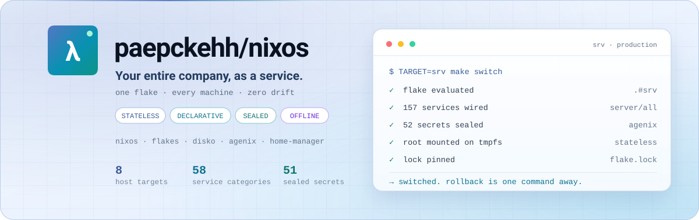

<div align="center">

<picture>
  <source media="(prefers-color-scheme: dark)" srcset="docs/hero-dark.svg">
  <source media="(prefers-color-scheme: light)" srcset="docs/hero-light.svg">
  
</picture>

# ⚡ paepckehh/nixos

**Your entire company, as a service.**

Servers, desktops, routers, IoT, cloud services, secrets and network.
One flake. Every machine. Declared in Nix, sealed with agenix, reproducible
down to the last byte.

[](https://github.com/paepckehh/nixos)
[](https://nixos.org)
[](https://github.com/paepckehh/nixos/blob/main/flake.lock)
[](https://github.com/paepckehh/nixos/tree/main/storage)
[](https://github.com/paepckehh/nixos/tree/main/modules/resources)
[](https://github.com/paepckehh/nixos/commits/main)
[](LICENSE)

`TARGET=srv make switch`

<picture>
  <source media="(prefers-color-scheme: dark)" srcset="docs/established-dark.svg">
  <source media="(prefers-color-scheme: light)" srcset="docs/established-light.svg">
  
</picture>

</div>

---

## 💡 Why

Not a dotfiles repo. Not a Kubernetes wrapper. An operating model.

- 🧊 **Reboot is a factory reset.** Root is tmpfs. Only `/nix/persist` survives.
- 🔐 **Secrets are hardware.** YubiKey and agenix, never a `.env` file in git.
- 📦 **One repo, every machine.** Servers, laptops, routers, ESP32s, IoT.
- 🛰 **Offline-first.** Every upstream flake is mirrored. Builds work air-gapped.
- 🎛 **Feature flags, not forks.** Commented imports are the service catalog.
- 🧹 **One formatter.** `alejandra`. No debates, no drift.

## 🚀 Quickstart

```bash
git clone https://github.com/paepckehh/nixos /etc/nixos
cd /etc/nixos
make check                 # format, evaluate, typecheck the flake
TARGET=srv make switch     # build and ship
```

> The Makefile assumes `/etc/nixos`. Flake inputs point at a private git mirror;
> use your own mirror or the commented public inputs in `flake.nix`.
> `make check` rewrites formatting and stages files. It is not a read-only lint.

## 🎯 Profiles

| Target | What it is |
|---|---|
| `srv` | Reference production server. Stateless + LUKS, Caddy, DNS, git mirror, services. The only target that currently receives `infra`. |
| `srv2` | Secondary server. Alternate storage layout, devops core, GNOME. |
| `srv-full` | Everything-enabled catalog. The golden build. |
| `kiosk` | Locked-down kiosk desktop. Stateless, no encryption. |
| `internet` | Browser desktop. Stateless + LUKS. |
| `client` | Live client image with GNOME and Home Manager. |
| `iso` | Bootable live ISO built from the `client` config. |
| `iso-installer` | Automated disko installer image. Work in progress. |

```bash
TARGET=kiosk make build    # any target, same command
```

## 🧩 The stack, in one screen

| Layer | What ships |
|---|---|
| **Core** | Bind, Blocky, Unbound, DNSCrypt, AdGuard, Authelia SSO, LLDAP, step-ca, certwarden, Chrony |
| **Comms** | Maddy, Stalwart, Roundcube, Matrix/Element, ntfy, Miniflux, webmail and autoconfig |
| **Ops** | Prometheus, Grafana, Loki, Wazuh, NetAlertX, Uptime Kuma, syslog-ng, WireGuard, Netbird |
| **Data** | MySQL, MongoDB, Nextcloud, OpenCloud, Paperless-ngx, Immich, Jellyfin, Zipline, file drops |
| **AI** | Ollama, Open WebUI, Crush, LibreTranslate, paperless-ai |
| **Business** | ERPNext, Zammad, Kimai, TimeOff, Vikunja, OnlyOffice, CRM, HR |
| **Platform** | Proxmox, Guacamole, RDP gateways, OpenVSCode, n8n, OliveTin, Atuin |
| **Edge** | OpenWRT firmware, ESP32 guard nodes, Home Assistant, EcoFlow, Tibber, Moode |
| **Storage** | Stateless root, LUKS, disko, ZFS, RAIDZ, rsync + snapshot backups |

**58 service categories. One import line each.** Browse
[`server/`](server/README.md) and uncomment what you need.

## 🏗 Architecture

```text
flake.nix                     entry point, hosts, feature flags
├── configuration.nix         global NixOS defaults and hardening
├── siteconfig/config.nix     the single source of truth: IDs, IPs, domains, ports
├── hardware/                 CPU, GPU and device profiles
├── storage/                  stateless, LUKS, ZFS and disko layouts
├── role/                     adm, server and docker baselines
├── hosts/                    per-host identity and network wiring
├── person/ user/             Home Manager and human-level config
├── packages/                 base, devops, desktop, AI package sets
├── server/all/               the 157 real service modules; category dirs are symlinks
├── client/                   WireGuard, caches, RootCA, YubiLock, OpenSnitch
├── openwrt/ guard/ iot/      routers, guard nodes and smart devices
├── modules/resources/        51 encrypted .age secrets
├── lib/                      shared harden, proxy and host helpers
└── docs/                     hero art and visual identity
```

`infra.<service>.id` sets both the last IPv4 octet and the loopback port
(`7000 + id`). Add a service, allocate an ID, get a consistent address,
port, FQDN, URL and reverse-proxy target for free.

## 🔐 Secrets and impermanence

```nix
age.secrets.vaultwarden.file = ../../modules/resources/vaultwarden.age;
```

- Encrypted with [agenix](https://github.com/ryantm/agenix), one `.age` file per service.
- Decrypted by the persisted host key at `/nix/persist/etc/ssh/ssh_host_ed25519_key`.
- Never edit `.age` files by hand. Never commit plaintext.
- `/` is tmpfs. `/nix/persist` is the only memory. Reboot clean, boot same.

## 🕹 Command deck

| Command | Result |
|---|---|
| `make check` | Format, stage, evaluate `.#<TARGET>` |
| `make build` | Build and install a boot entry |
| `make switch` | Build and activate now |
| `make boot` | `build`, then reboot into it |
| `make rollback` | Back to the previous generation |
| `make update` | Archive `flake.lock`, then update inputs |
| `make world` | Mirror refresh, update, build, GC |
| `make gc` / `make clean` | Reclaim store space, rebuild clean |
| `make sdb` / `make usb` | Provision a disk from `storage/Makefile` (destructive) |

Direct, if you prefer:

```bash
nixos-rebuild switch --flake .#srv
nix flake check
alejandra --quiet .
```

## 📂 Repo map

| Directory | Read this for |
|---|---|
| [`server/`](server/README.md) | 58 categories of self-contained NixOS services |
| [`storage/`](storage/README.md) | Disko layouts, stateless root, ZFS, backups |
| [`hosts/`](hosts/README.md) | Per-server identity and overrides |
| [`role/`](role/README.md) | Admin, server and docker baselines |
| [`siteconfig/`](siteconfig/README.md) | IDs, networks, domains, aliases, ports |
| [`packages/`](packages/README.md) | Package sets from base to AI and wine |
| [`client/`](client/README.md) | WireGuard, caches, RootCA, OpenSnitch, YubiLock |
| [`openwrt/`](openwrt/README.md) | Router firmware builder and fleet |
| [`guard/`](guard/README.md) | Hardened OpenWRT and ESP32 guard nodes |
| [`iot/`](iot/README.md) | Home Assistant, EcoFlow, Tibber, Moode, DAB |
| [`modules/`](modules/README.md) | 51 agenix secrets, key tooling, hardening |
| [`person/`](person/README.md) | People, smartcards and SSH identities |
| [`user/`](user/README.md) | Home Manager, shell, browsers, dotfiles |
| [`admin/`](admin/README.md) | Key generation and admin shortcuts |
| [`shared/`](shared/README.md) | Brand assets, YARA rules, bookmarks |
| [`lib/`](lib/) | Harden, proxy and host helpers |
| [`doc/`](doc/README.md) | ZFS notes, DNS, ESP32, Crush config |
| [`docs/`](docs/) | Theme-aware SVG hero and banner art |
| [`.attic/`](.attic/README.md) | 100 archived lock snapshots and retired configs |

## 🧠 Rules of the house

| Principle | In practice |
|---|---|
| **Stateless** | Root on tmpfs. `/nix/persist` is sacred. |
| **Declarative** | If it is not in Nix, it does not exist. |
| **Modular** | Every service is one file, one import, one blast radius. |
| **Sealed** | Hardware-backed keys. No plaintext secrets. Ever. |
| **Pinned** | `flake.lock` plus archived snapshots for every rollback. |
| **Boring on purpose** | No Kubernetes, no Helm, no Terraform. Nix does the job. |

## 🛠 Status

Rapid prototyping by design. This is a working lab, not a shrink-wrapped
product. Read the diff before you deploy it. Wild ideas and sharp PRs welcome.

**Snapshot:** 554 `.nix` files (449 live, 105 archived), 157 service modules in
58 categories, 51 sealed secrets, 8 flake targets, 3,670 commits, 36 tags.

**Code:** humans. **Docs:** CrushAI. **Review:** both.

## 📚 Documentation

This README is the map; the directory READMEs are the territory. Pick a trail:

| You want to… | Read in this order |
|---|---|
| **Ship a host** | [Profiles](#-profiles) → [Command deck](#-command-deck) → [`hosts/`](hosts/README.md) |
| **Add a service** | [`server/`](server/README.md) → [`siteconfig/`](siteconfig/README.md) → [`modules/`](modules/README.md) |
| **Understand storage** | [`storage/`](storage/README.md) → [`ZFS.md`](storage/ZFS.md) → [`BACKUP.md`](storage/BACKUP.md) |
| **Extend the edge** | [`openwrt/`](openwrt/README.md) → [`guard/`](guard/README.md) → [`iot/`](iot/README.md) → [`freifunk/`](freifunk/README.md) |

Reference shelf:

- 🧩 **Service catalog** — 157 modules in 58 categories: [`server/README.md`](server/README.md)
- ⚙️ **Single source of truth** — IDs, IPs, domains, ports: [`siteconfig/README.md`](siteconfig/README.md)
- 🔐 **Secrets and trust** — 51 sealed files, rotation rules: [`modules/README.md`](modules/README.md)
- 💾 **Disks and restores** — impermanence, ZFS, rsync: [`storage/README.md`](storage/README.md)
- 📝 **Runbooks** — SSH, syslog-ng, ESP32, Crush: [`doc/README.md`](doc/README.md)
- 🎨 **Visual identity** — hand-built SVGs: [`docs/`](docs/) ([light](docs/hero-light.svg) · [dark](docs/hero-dark.svg))

> Every markdown file follows the same GitHub style on purpose: badges, compact
> tables, working links, verified counts. If a doc disagrees with the code, the
> code wins and the doc is a bug.

## 🤝 Contributing

This is a live lab, not a museum. Sharp PRs, reproductions and wild ideas are welcome.

1. Read [`flake.nix`](flake.nix) and the relevant `infra.<name>` block before touching a service.
2. Run `ls -l` on any `server/<category>/file.nix`. It is probably a symlink into `server/all/`.
3. Format with `alejandra --quiet .`. It is the only accepted formatter; do not add another.
4. Verify with `nix-instantiate --parse <file>` at minimum. Full evaluation needs the Nix daemon and the private mirror.
5. Never commit a `.age` file, a plaintext secret, or a "cleanup" of commented-out feature flags.

One topic per PR. Fix the target you came for; leave unrelated breakage for its own change.
Found a vulnerability or a leaked secret? Report it privately to the maintainer, not in a public issue.

## ⚖️ License

**MIT.** See [LICENSE](LICENSE).

Copyright (c) 2024-2026 Michael Paepcke.

You may use, copy, modify, merge, publish, distribute, sublicense and sell
copies of this repository, provided the copyright notice and permission notice
are included. The software is provided "as is", without warranty of any kind.

Scope notes:

- The license covers the code, configuration and documentation in this repository.
- Encrypted secrets (`.age`) remain useless without their keys and are not
  intended for reuse. Do not deploy anyone else's site values.
- Third-party components, trademarks and brand assets keep their own terms.

If you build on this fleet, keep the notice and consider linking back.

## 📖 Citation

If you reference this fleet in a talk, an article or another repository:

```bibtex
@misc{paepckehh-nixos,
  author       = {Michael Paepcke},
  title        = {paepckehh/nixos: your entire company as a service},
  year         = {2024},
  publisher    = {GitHub},
  journal      = {GitHub repository},
  howpublished = {\url{https://github.com/paepckehh/nixos}},
  note         = {NixOS fleet: servers, desktops, routers and IoT; stateless root, disko, agenix}
}
```

Plain text: Paepcke, M. (2024). *paepckehh/nixos: your entire company as a service*.
GitHub. <https://github.com/paepckehh/nixos>

For reproducibility, cite the tag you actually deployed:

```bash
git describe --tags --abbrev=0   # e.g. v0.1.1032
```

<p align="right"><sub>Built with Nix, caffeine and a healthy distrust of snowflake servers.</sub></p>
